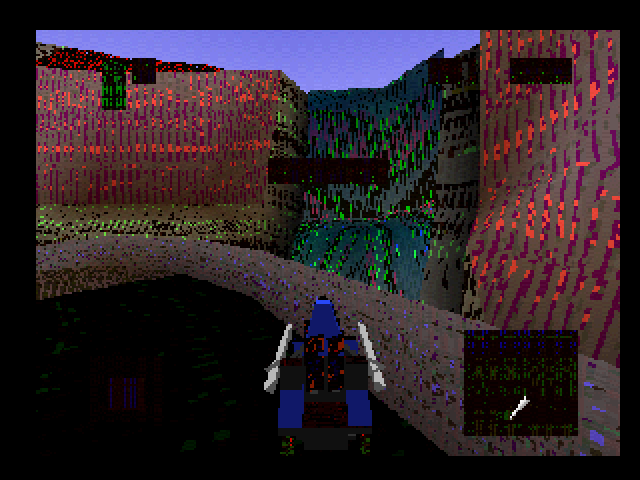
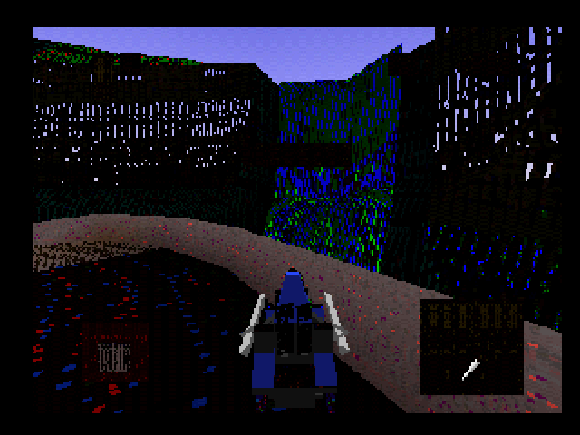
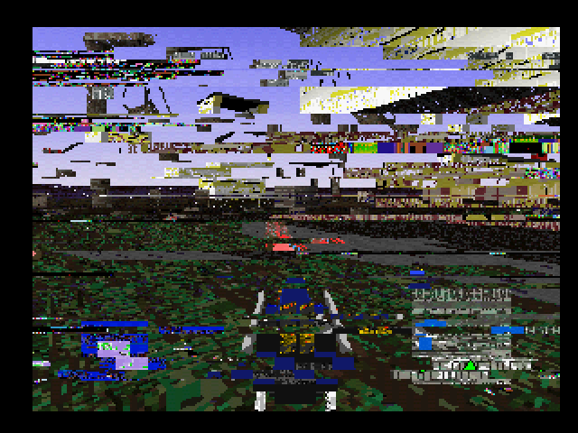
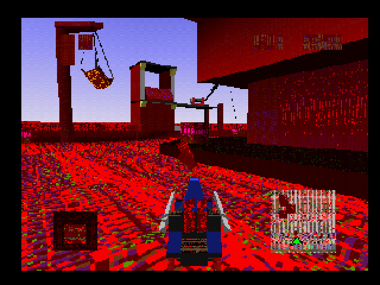
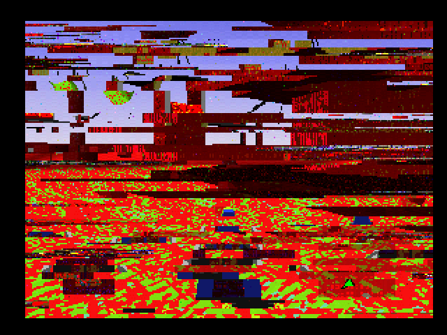
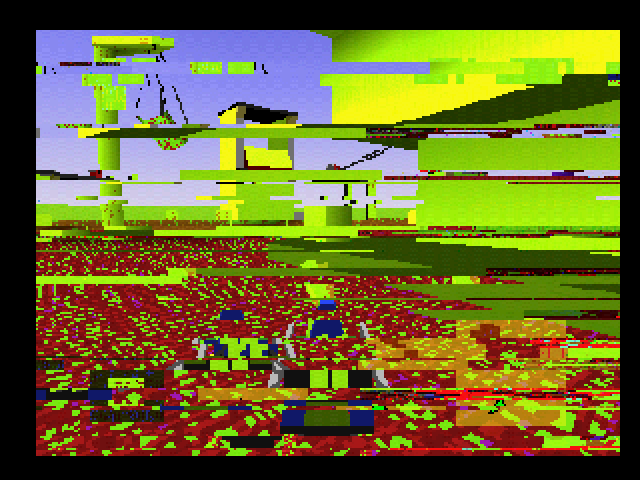
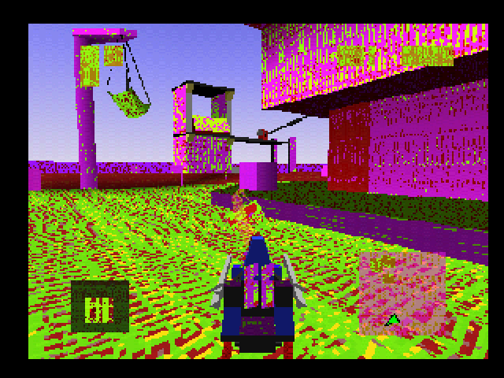
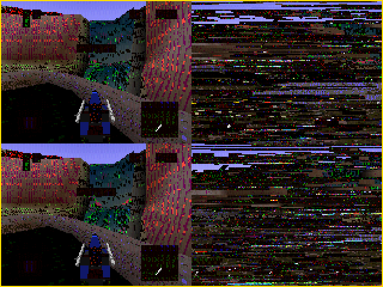

# texel-rot

Frontend libretro em C++/SDL3 que roda um core de emulador e corrompe o
**visual** em tempo real: texturas na VRAM e a imagem final. Não altera o
código do conteúdo emulado.

## Exemplos

| | | |
|---|---|---|
|  |  |  |
| texturas das paredes corrompidas | texturas apagadas em padrão de pontos | faixas deslocadas na imagem final |
|  |  |  |
| paleta alterada, forma intacta | faixas e cor juntas | mosaico de blocos e cores |
|  |  | |
| cores trocadas nas superfícies | visualização da VRAM (F1) | |

## Compilar e rodar

Requer SDL3, CMake, Ninja e um core libretro (padrão: Beetle PSX,
pacote `libretro-beetle-psx`). A BIOS vai em `sistema/` (ex.: `scph5501.bin`).

```bash
cmake -S . -B build -G Ninja
cmake --build build
./build/app caminho/do/conteudo.cue [caminho/do/core.so]
```

As corrupções de VRAM dependem de cores cujo estado salvo guarda a VRAM
(`GPURAM`, Beetle PSX). Com outros cores, só os efeitos de imagem funcionam.

## Resolução e capturas

O quadro mantém a largura e a altura entregues pelo core, inclusive quando
mudam durante o jogo. F12 salva um PNG nessa resolução, sem redução para
320×240 nem ampliação artificial. Em F1, a visualização da VRAM é 1024×512.
A janela ajusta apenas a apresentação; os pixels exportados não são reduzidos.
Capturas antigas permanecem intactas. Testes: `ctest --test-dir build --output-on-failure`.

## Teclas

| | |
|---|---|
| setas, Z X A S, Enter, Backspace, Q W E R | RetroPad |
| **C** | aplica o molde atual na região |
| **K / L** | molde anterior / próximo |
| **F1** | mostra a VRAM e a região selecionada |
| **, .** | página de textura anterior / próxima |
| **B** | região: página ↔ VRAM inteira |
| **U** | desfaz a última corrupção |
| **0–9** | intensidade de faixas/blocos na imagem final |
| **Tab / M** | roteiro automático de 16 s / mapa radial ou uniforme |
| **F5–F7 / F9–F11** | salva / carrega estado |
| **P / F12 / Esc** | pausa / captura PNG em `capturas/` / sai |

## Moldes

poeira · deriva · eco · cisalhamento · febre · erosão · espelho

## Créditos

`third_party/libretro/libretro.h` — MIT, The RetroArch team.
